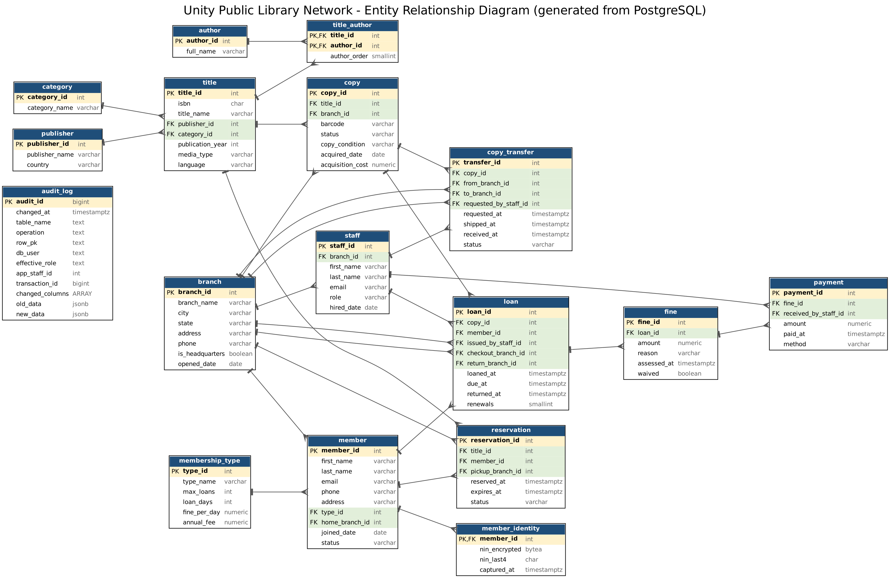
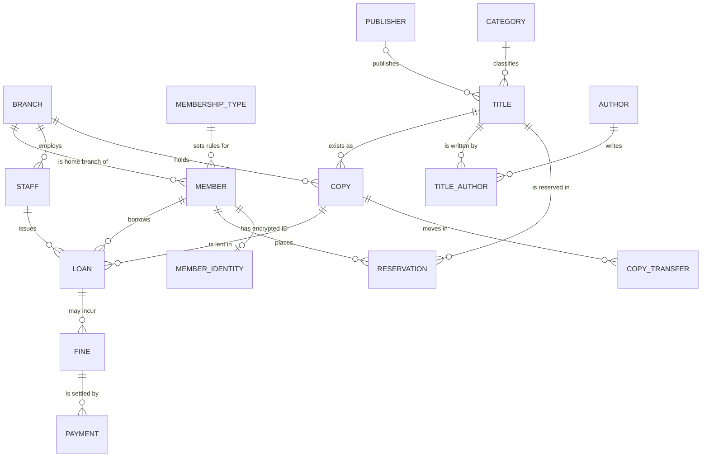

# Portfolio 1: Database Design and Modelling

**Course:** MIT 8103 Advanced Database Systems  
**Case study:** Unity Public Library Network (UPLN), a fictional organisation developed for this assessment  
**Database platform:** PostgreSQL 16, deployed with Docker in a GitHub Codespace

## Repository Structure and Contents

This directory contains the database schema, sample dataset, implementation scripts, repeatable test procedures and supporting evidence for Portfolio 1. The scripts document both the controls implemented and the procedures used to verify their behaviour.

| File or directory | Purpose |
|---|---|
| [`Akosa_Antonella_301929153_P1_01_schema.sql`](Akosa_Antonella_301929153_P1_01_schema.sql) | Creates the 15 core tables, primary and foreign keys, constraints and initial fine-balance view |
| [`Akosa_Antonella_301929153_P1_02_sample_data.sql`](Akosa_Antonella_301929153_P1_02_sample_data.sql) | Populates the schema with a small, consistent synthetic dataset |
| [`Akosa_Antonella_301929153_P1_03_constraint_tests.sql`](Akosa_Antonella_301929153_P1_03_constraint_tests.sql) | Executes 18 negative integrity tests and a valid-loan test to assess constraint enforcement |
| [`Akosa_Antonella_301929153_P1_04_security_privacy.sql`](Akosa_Antonella_301929153_P1_04_security_privacy.sql) | Implements database roles, least-privilege permissions, privacy-preserving views and row-level security |
| [`Akosa_Antonella_301929153_P1_05_security_tests.sql`](Akosa_Antonella_301929153_P1_05_security_tests.sql) | Executes 14 permission tests and demonstrates data masking and row-level filtering |
| [`Akosa_Antonella_301929153_P1_06_audit_log.sql`](Akosa_Antonella_301929153_P1_06_audit_log.sql) and [`Akosa_Antonella_301929153_P1_06b_audit_demo.sql`](Akosa_Antonella_301929153_P1_06b_audit_demo.sql) | Implements the audit log (table 16), then generates sample activity to demonstrate its operation |
| [`Akosa_Antonella_301929153_P1_07_audit_tests.sql`](Akosa_Antonella_301929153_P1_07_audit_tests.sql) | Executes 18 tests of audit recording, access restrictions and tamper resistance |
| [`Akosa_Antonella_301929153_P1_08_payment_guard.sql`](Akosa_Antonella_301929153_P1_08_payment_guard.sql) and [`Akosa_Antonella_301929153_P1_08b_payment_guard_tests.sql`](Akosa_Antonella_301929153_P1_08b_payment_guard_tests.sql) | Implements fine-payment validation and executes six integrity tests |
| [`Akosa_Antonella_301929153_P1_09_authentication.sql`](Akosa_Antonella_301929153_P1_09_authentication.sql) and [`Akosa_Antonella_301929153_P1_09b_login_tests.sh`](Akosa_Antonella_301929153_P1_09b_login_tests.sh) | Creates demonstration login accounts and tests authentication and associated privileges |
| [`Akosa_Antonella_301929153_P1_10_encryption.sql`](Akosa_Antonella_301929153_P1_10_encryption.sql) and [`Akosa_Antonella_301929153_P1_10b_run_encryption.sh`](Akosa_Antonella_301929153_P1_10b_run_encryption.sh) | Implements encrypted member identification data (table 17), demonstrates password hashing and executes ten tests |
| [`Akosa_Antonella_301929153_P1_11_sql_injection_demo.sql`](Akosa_Antonella_301929153_P1_11_sql_injection_demo.sql) | Demonstrates SQL injection, parameterised-query protection and the effect of restricted permissions |
| [`Akosa_Antonella_301929153_P1_er_diagram.png`](Akosa_Antonella_301929153_P1_er_diagram.png) and [`Akosa_Antonella_301929153_P1_er_diagram.svg`](Akosa_Antonella_301929153_P1_er_diagram.svg) | Entity–relationship diagram generated from the implemented database |
| [`Akosa_Antonella_301929153_P1_er_diagram.mmd`](Akosa_Antonella_301929153_P1_er_diagram.mmd) | Mermaid source describing the principal entities and relationships |
| [`Akosa_Antonella_301929153_P1_build_er_diagram.py`](Akosa_Antonella_301929153_P1_build_er_diagram.py) | Generates the database diagram from the live schema |
| [`evidence/`](evidence/) | Screenshots recording the execution and outcomes of the portfolio activities |

---

## 1. Case Study, Objectives and Scope

The **Unity Public Library Network (UPLN)** is a fictional public library system with five branches: the Abuja headquarters, Lagos, Port Harcourt, Kano and Enugu. Its branches share a catalogue and support member registration, the borrowing and return of library materials, reservations, transfers between branches, overdue fines and fine payments. The proposed database supports librarians, branch managers, headquarters administrators and member-facing services.

| Aspect | Description |
|---|---|
| **System purpose** | Management of library collections, membership and circulation activities across five Nigerian cities |
| **Database users** | Members, librarians, branch managers and headquarters administrators |
| **Principal data entities** | Branches, membership types, members, staff, publishers, authors, categories, titles, copies, loans, reservations, transfers, fines and payments |
| **Core operations** | Member registration; catalogue search; borrowing and returning copies; reservations; copy transfers; fine assessment and payment; operational reporting |

All records used in the assessment are synthetic, including names, email addresses and ISBNs. Monetary amounts are represented in Nigerian naira (₦).

**Objective and scope.** I designed and implemented UPLN's relational database in PostgreSQL 16, focusing on entity–relationship modelling, schema design, normalisation, referential and business-rule integrity, controlled access to sensitive data and verification of database behaviour. The implementation comprises 15 core tables and two additional tables for audit logging and encrypted identity data, giving 17 tables in total. I executed the scripts within a Docker-based GitHub Codespace and recorded the results for assessment.

### 1.1 Business Rules and Integrity Controls

The schema translates UPLN's operating requirements into constraints so that invalid data can be rejected by PostgreSQL, including when an application does not perform the corresponding validation.

| ID | Business rule | Database enforcement |
|---|---|---|
| R1 | No more than one branch may be designated as headquarters; Abuja is designated in the sample dataset | Partial unique index `uq_one_headquarters`. The index prevents a second headquarters but does not require a headquarters record to exist |
| R2 | Each physical copy may have only one active loan at a time | Partial unique index `uq_one_active_loan_per_copy` |
| R3 | A member may have only one open reservation for the same title | Partial unique index `uq_one_open_reservation` |
| R4 | A loan's due date must not precede its start date; a returned loan must identify the return branch | `CHECK` constraints on `loan` |
| R5 | A copy transfer must reference different source and destination branches | `CHECK` constraint on `copy_transfer` |
| R6 | Email addresses and barcodes must be unique; provided ISBNs must be unique and satisfy the defined format | `UNIQUE` and `CHECK` constraints |
| R7 | Monetary values and status fields must remain within their defined ranges and permitted values | `CHECK` constraints |
| R8 | Records must not reference non-existent parent records | Foreign-key constraints |

The distinction in R1 is intentional: a uniqueness rule prevents duplicate headquarters designations, while an additional control would be needed to guarantee that one headquarters always exists.

---

## 2. Entity–Relationship Modelling

The diagram shown below was generated from the PostgreSQL database using `Akosa_Antonella_301929153_P1_build_er_diagram.py`, so it can be compared with the implemented table definitions. Within the generated diagram, yellow denotes primary-key columns and green denotes foreign-key columns; the relationship symbols indicate cardinality.



The following Mermaid diagram summarises the principal relationships. The generated diagram and [`Akosa_Antonella_301929153_P1_er_diagram.mmd`](Akosa_Antonella_301929153_P1_er_diagram.mmd) contain the more detailed representation.



The `audit_log` table does not contain foreign keys to the operational tables. It records changes across different entity types and is designed to preserve the audit record independently of the continued existence of the affected operational row.

### 2.1 Entity Relationships and Cardinality

- **Titles and copies:** `title` represents a catalogue entry, whereas `copy` represents a specific physical item identified by its barcode and associated with a branch. A title may have several copies, but each copy references one title. Separating these entities permits the same work to be held at multiple branches without duplicating its catalogue description.
- **Titles and authors:** Authors and titles have a many-to-many relationship. The `title_author` junction table resolves this relationship, and its composite primary key (`title_id`, `author_id`) prevents the same author–title association from being recorded twice.
- **Members and loans:** A loan associates a member with a particular copy and records the issuing staff member, checkout branch and, where applicable, return branch. These locations are recorded separately because a member may return an item at a different branch.
- **Loans, fines and payments:** A loan may give rise to a fine, while a fine may be settled by several payments. This design supports partial payments without requiring the outstanding fine balance to be stored as a separate, manually updated value.

These relationships informed the foreign keys and the separation of catalogue, circulation and financial records in the implemented schema.

---

## 3. Relational Schema and Design Decisions

The schema definitions are provided in [`Akosa_Antonella_301929153_P1_01_schema.sql`](Akosa_Antonella_301929153_P1_01_schema.sql). In the table below, PK denotes primary key, FK foreign key and UQ a unique constraint.

| Table | Primary key | Foreign keys | Notable constraints and design features |
|---|---|---|---|
| `branch` | `branch_id` | None | UQ `branch_name`; at-most-one-headquarters rule (R1) |
| `membership_type` | `type_id` | None | UQ `type_name`; positive loan limits and durations; non-negative fees and rates |
| `member` | `member_id` | `type_id` → `membership_type`; `home_branch_id` → `branch` | UQ `email` with format check; allowed membership status values |
| `staff` | `staff_id` | `branch_id` → `branch` | UQ `email`; allowed staff roles |
| `publisher` | `publisher_id` | None | UQ `publisher_name` |
| `author` | `author_id` | None | Author details held separately from titles |
| `category` | `category_id` | None | UQ `category_name` |
| `title` | `title_id` | `publisher_id` → `publisher`; `category_id` → `category` | UQ `isbn` when provided (13 digits); permitted media types: `book`, `dvd`, `audiobook`, `magazine` |
| `title_author` | (`title_id`, `author_id`) | `title_id` → `title`; `author_id` → `author` | Composite PK; `author_order` ≥ 1 |
| `copy` | `copy_id` | `title_id` → `title`; `branch_id` → `branch` | UQ `barcode`; constrained copy status and condition |
| `loan` | `loan_id` | `copy_id`, `member_id`, `issued_by_staff_id`, `checkout_branch_id`, `return_branch_id` | Active-loan uniqueness; due-date and return-date checks; renewals limited to 0–2 |
| `reservation` | `reservation_id` | `title_id`, `member_id`, `pickup_branch_id` | One open reservation per member and title; expiry after reservation time |
| `copy_transfer` | `transfer_id` | `copy_id`, `from_branch_id`, `to_branch_id`, `requested_by_staff_id` | Source and destination differ; transfer timestamps ordered |
| `fine` | `fine_id` | `loan_id` → `loan` | UQ (`loan_id`, `reason`); positive amount |
| `payment` | `payment_id` | `fine_id` → `fine`; `received_by_staff_id` → `staff` | Positive amount; restricted payment methods |
| `audit_log` (added by `Akosa_Antonella_301929153_P1_06_audit_log.sql`) | `audit_id` | None, by design | Recorded operation limited to `INSERT`, `UPDATE` or `DELETE`; append-only controls described in Section 7.5 |
| `member_identity` (added by `Akosa_Antonella_301929153_P1_10_encryption.sql`) | `member_id` | `member_id` → `member` | One-to-one extension; encrypted NIN and four-digit display suffix |

The core schema creates 15 tables. The audit and encryption activities introduce `audit_log` and `member_identity`, bringing the implemented model to **17 tables**. The view `v_fine_balance` calculates amounts paid and balances outstanding from the fine and payment records; additional reporting and audit views are introduced by the security scripts.

**Primary-key design.** Most entity tables use integer surrogate primary keys generated with `GENERATED ALWAYS AS IDENTITY`. This avoids using mutable attributes, such as names or email addresses, as relationship identifiers. The `title_author` table instead uses the composite key (`title_id`, `author_id`) because that pair uniquely identifies an author–title association. Natural identifiers remain protected by unique constraints where required.

**Indexing approach.** The initial implementation includes the indexes required for primary keys, unique constraints and conditional uniqueness rules. Additional query-performance indexes were deliberately left for Portfolio 2, where their effect could be benchmarked. The audit implementation separately creates `idx_audit_table_row` and `idx_audit_changed_at` on `audit_log` to support searches by affected record and time. PostgreSQL does not automatically create an index on every referencing foreign-key column.

---

## 4. Integrity Constraints: Implementation and Validation

Integrity constraints were implemented within PostgreSQL to enforce entity identity, referential validity and business rules independently of the client issuing an operation.

| Mechanism | Schema example | Integrity requirement |
|---|---|---|
| Primary key | `copy.copy_id` | Every copy has a unique identifier |
| Composite primary key | `title_author (title_id, author_id)` | An author–title association cannot be duplicated |
| Foreign key | `loan.member_id` → `member.member_id` | A loan must reference an existing member |
| `UNIQUE` | `copy.barcode`, `member.email` | Identifiers cannot be duplicated |
| `NOT NULL` | `member.last_name` | Required attributes cannot be omitted |
| `CHECK` | `fine.amount > 0` | Fine amounts must be positive |
| Partial unique index | `uq_one_active_loan_per_copy` | A copy cannot have two active loans simultaneously |

A key design choice was the use of a **partial unique index** for loan availability. The index `uq_one_active_loan_per_copy` enforces uniqueness on `copy_id` only where `returned_at IS NULL`. Consequently, the same copy may appear in multiple historical loans, but no second loan may remain active while an earlier loan is unreturned. This preserves loan history while enforcing the current lending restriction at the database level. The mechanism is described in the [PostgreSQL 16 partial-index documentation](https://www.postgresql.org/docs/16/indexes-partial.html).

**Validation procedure.** I used `Akosa_Antonella_301929153_P1_03_constraint_tests.sql` to submit 18 deliberately invalid operations and check that the database rejected them. The script also tests a valid loan and rolls back that demonstration transaction. The recorded results are shown in [`evidence/Akosa_Antonella_301929153_P1_03_constraint_tests.png`](evidence/Akosa_Antonella_301929153_P1_03_constraint_tests.png). These tests provide evidence that the specified constraints are active; they do not establish that every conceivable invalid operation has been tested.

---

## 5. Normalisation and Relational Design Trade-offs

The schema separates attributes according to their dependencies in order to reduce unnecessary duplication and the update, insertion and deletion anomalies associated with a single combined borrowing record. The process is illustrated below using UPLN's catalogue and circulation data.

### 5.1 Unnormalised Borrowing Record and Data Anomalies

An initial, unnormalised representation could place member, catalogue, copy and loan information in one record, with fields such as:

`member_name, member_email, membership_type, loan_days, fine_per_day, home_branch, branch_city, title, isbn, authors, publisher, publisher_country, copy_barcode, branch_holding_copy, loaned_at, due_at, returned_at`

This arrangement would create the following anomalies:

| Anomaly | Example within UPLN |
|---|---|
| **Update anomaly** | Changing the Student membership fine rate from ₦25 to ₦30 would require updates to every affected borrowing record; an omitted update could leave conflicting rates |
| **Insertion anomaly** | A new title or member could not be stored independently if the combined record required an associated loan |
| **Deletion anomaly** | Removing the only borrowing record for a particular member or title could also remove the only record of that member's or title's details |

The implemented relational schema addresses these issues by storing membership conditions, member details, catalogue information and circulation events in separate related tables.

### 5.2 First Normal Form (1NF)

The illustrative borrowing record includes `authors` as a potentially multi-valued field. I separated authors into an `author` table and recorded their associations with titles through `title_author`, so each row of the junction table represents one author–title association. This avoids storing a repeating list of authors in a single relational attribute.

### 5.3 Second Normal Form (2NF)

If the unnormalised borrowing record were identified by a combination such as member, copy and loan time, attributes describing the member or the copy would depend on only part of that combined identifier. For example, membership information depends on the member, while title and publisher information depend on the copy's associated title. The relational design therefore stores these attributes in their respective entity tables.

This composite identifier is used to explain the normalisation problem; **the implemented `loan` table uses `loan_id` as its primary key**. The `title_author` table provides an actual example of a composite primary key in the final design.

### 5.4 Third Normal Form (3NF)

The schema also separates attributes that would otherwise be transitively dependent on the identifier of another entity. The examples below show the dependencies addressed in the design.

| Dependency in a combined record | Potential issue | Implemented decomposition |
|---|---|---|
| `member_id → type_id → loan_days, fine_per_day, max_loans` | Membership rules repeated for each member | Store rules in `membership_type` and reference them from `member` |
| `title_id → publisher_id → publisher_country` | Publisher information repeated across titles | Store publisher information in `publisher` |
| `title_id → category_id → category_name` | Category names repeated across titles | Store categories in `category` |
| `member_id → home_branch_id → branch_city` | Branch details repeated across members | Store branch details in `branch` |

These decompositions reduce the risk that the same membership rule, publisher, category or branch is represented inconsistently across multiple records.

### 5.5 Boyce–Codd Normal Form (BCNF) Assessment

BCNF requires every determinant in a non-trivial functional dependency to be a superkey. I considered this requirement when identifying keys and separating attributes into their respective tables. For example, `member_id` is the declared primary key of `member`, and the non-null, unique `email` attribute is also a candidate key. Membership-type rules are placed in `membership_type` rather than repeated in `member`. In `title_author`, the pair (`title_id`, `author_id`) is the declared composite key of the association.

These examples support the normalisation decisions described above, but they are **not a formal proof that all 17 tables satisfy BCNF**. Such a claim would require a complete analysis of the functional dependencies applicable to each table. The demonstrated decomposition directly addresses the identified 1NF, 2NF and 3NF issues without overstating the scope of the BCNF assessment.

### 5.6 Controlled Redundancy and Operational State

Not every operational attribute can be evaluated solely by eliminating redundancy. Two attributes were retained to support day-to-day circulation functions, with their consistency implications identified explicitly.

| Design decision | Operational justification | Consistency risk and control |
|---|---|---|
| Store `copy.status` even though an active loan can be identified through `loan` | Enables direct availability checks and provides a row that can be locked during checkout | The stored status could disagree with an active loan. A reconciliation query detects discrepancies, while the transactions in Portfolio 3 update the relevant records together |
| Store `copy.branch_id` as the current holding branch | Supports efficient branch-level inventory checks | The recorded location must be maintained as transfers and returns occur. A complete reconciliation against transfer history was not implemented in this portfolio |

The `loan.checkout_branch_id` and `loan.return_branch_id` fields describe distinct circulation events, not merely the issuing employee's home branch. The library permits a return to a different branch, so the event locations must be recorded independently. Foreign keys validate that those branch records exist.

I did not introduce a separate paid/unpaid flag for fines. Instead, the `v_fine_balance` view derives the amount paid and outstanding balance from the underlying `fine` and `payment` records, avoiding the need to keep a duplicated status field synchronised with the payment history.

The following query checks whether the stored copy status agrees with the presence of an active loan. When the two representations are consistent, the expected result is zero rows:

```sql
SELECT c.copy_id, c.status, l.loan_id
FROM copy c
LEFT JOIN loan l ON l.copy_id = c.copy_id AND l.returned_at IS NULL
WHERE (c.status = 'on_loan') <> (l.loan_id IS NOT NULL);
```

---
## 6. Implementation, Execution and Test Verification

### 6.1 Execution Environment and Procedure

The implementation was executed against PostgreSQL 16 in Docker within a GitHub Codespace. From the repository root, the database container must first be started with `docker compose -f Akosa_Antonella_301929153_docker-compose.yml up -d`. The following commands execute the portfolio activities in the documented dependency order:

```bash
docker compose -f Akosa_Antonella_301929153_docker-compose.yml exec -T postgres psql -U library_admin -d upln -v ON_ERROR_STOP=1 < portfolio-1-database-design/Akosa_Antonella_301929153_P1_01_schema.sql
docker compose -f Akosa_Antonella_301929153_docker-compose.yml exec -T postgres psql -U library_admin -d upln -v ON_ERROR_STOP=1 < portfolio-1-database-design/Akosa_Antonella_301929153_P1_02_sample_data.sql
docker compose -f Akosa_Antonella_301929153_docker-compose.yml exec -T postgres psql -U library_admin -d upln < portfolio-1-database-design/Akosa_Antonella_301929153_P1_03_constraint_tests.sql
docker compose -f Akosa_Antonella_301929153_docker-compose.yml exec -T postgres psql -U library_admin -d upln -v ON_ERROR_STOP=1 < portfolio-1-database-design/Akosa_Antonella_301929153_P1_04_security_privacy.sql
docker compose -f Akosa_Antonella_301929153_docker-compose.yml exec -T postgres psql -U library_admin -d upln < portfolio-1-database-design/Akosa_Antonella_301929153_P1_05_security_tests.sql
docker compose -f Akosa_Antonella_301929153_docker-compose.yml exec -T postgres psql -U library_admin -d upln -v ON_ERROR_STOP=1 < portfolio-1-database-design/Akosa_Antonella_301929153_P1_06_audit_log.sql
docker compose -f Akosa_Antonella_301929153_docker-compose.yml exec -T postgres psql -U library_admin -d upln < portfolio-1-database-design/Akosa_Antonella_301929153_P1_06b_audit_demo.sql
docker compose -f Akosa_Antonella_301929153_docker-compose.yml exec -T postgres psql -U library_admin -d upln < portfolio-1-database-design/Akosa_Antonella_301929153_P1_07_audit_tests.sql
docker compose -f Akosa_Antonella_301929153_docker-compose.yml exec -T postgres psql -U library_admin -d upln -v ON_ERROR_STOP=1 < portfolio-1-database-design/Akosa_Antonella_301929153_P1_08_payment_guard.sql
docker compose -f Akosa_Antonella_301929153_docker-compose.yml exec -T postgres psql -U library_admin -d upln < portfolio-1-database-design/Akosa_Antonella_301929153_P1_08b_payment_guard_tests.sql
bash portfolio-1-database-design/Akosa_Antonella_301929153_P1_09b_login_tests.sh
bash portfolio-1-database-design/Akosa_Antonella_301929153_P1_10b_run_encryption.sh
docker compose -f Akosa_Antonella_301929153_docker-compose.yml exec -T postgres psql -U library_admin -d upln < portfolio-1-database-design/Akosa_Antonella_301929153_P1_11_sql_injection_demo.sql
```

The sequence is necessary because later tests depend on tables, roles, functions or triggers established in earlier stages. The audit demonstration, `Akosa_Antonella_301929153_P1_06b_audit_demo.sql`, performs four sample changes that generate persistent entries in `audit_log`. By contrast, the authentication and encryption test runners generate their demonstration credentials and keys during execution rather than placing those values in the repository. The separate static development password described in Section 7.10 is a known limitation of this laboratory configuration.

**Reset and repeatability.** The scripts are intended for a disposable synthetic test environment. Rerunning `Akosa_Antonella_301929153_P1_01_schema.sql` drops and recreates the 15 core tables, so it is **destructive** to data already held in those tables. Following a schema reset, the relevant security, audit, payment and encryption scripts must be executed again to restore their dependencies. This procedure must not be used on a database containing records that need to be preserved.

The diagram can be regenerated using the PostgreSQL client and Graphviz. The commands below reflect the supplied laboratory configuration:

```bash
sudo apt-get update && sudo apt-get install -y postgresql-client graphviz
cd portfolio-1-database-design
PGHOST=localhost PGUSER=library_admin PGPASSWORD=library_dev_pw PGDATABASE=upln python3 Akosa_Antonella_301929153_P1_build_er_diagram.py
```

### 6.2 Test Procedures and Recorded Outcomes

The tests combine positive cases, which establish that permitted operations succeed, and negative cases, which establish that specified invalid operations or unauthorised actions are rejected. The recorded outcomes from the portfolio are summarised below; evidence files are mapped to the tests in Section 8.

| Activity | Recorded verification outcome |
|---|---|
| Schema creation | The schema executed without reported errors; `\dt` displayed the 15 core tables before the two security-related tables were introduced |
| Sample data loading | Five branches, three membership types, eight members, eight staff, ten titles, 19 copies, ten loans and three fines were loaded |
| Integrity constraint testing | All 18 deliberate invalid-operation tests returned `PASS (rejected)`; a valid loan was accepted and its test transaction rolled back |
| Security and permissions | All 14 access-control tests passed; row-level security demonstrations returned two loans for member 1, two for member 7, none without a member identity and all ten for the permitted librarian role |
| Audit logging | The demonstration generated four audit entries and refused a tampering attempt; all 18 audit tests passed |
| Payment validation | All six fine-payment integrity tests passed |
| Authentication | An incorrect password was rejected with `FATAL: password authentication failed`; the librarian account could neither delete loans nor read the audit log; the audit trail identified the demonstrated login |
| Encryption and hashing | All ten tests passed, covering encryption, decryption, incorrect-key behaviour, restricted access, redaction and password hashing |
| SQL injection demonstration | The unsafe search returned 1, 8 and 8 rows across its three test inputs; the parameterised version returned 1, 0 and 0; the restricted-role data-access attempt was rejected |

The recorded PASS results describe the scenarios exercised by the corresponding scripts, not exhaustive assurance of all possible inputs or production conditions.

**Additional observation.** After several unsuccessful insert attempts, the valid test loan received an identifier higher than the next consecutive value. This is expected PostgreSQL behaviour because values obtained from sequences are not reversed by transaction rollback. The gaps therefore did not indicate missing loan records; they illustrated that identity-generated keys provide uniqueness, not gap-free numbering.

---

## 7. Security and Privacy Implementation

The UPLN model contains member contact details, an identity-number demonstration and borrowing records that may reveal individual reading preferences. Although the assessment uses synthetic data, the security implementation was designed around controlled authentication, authorisation, data exposure, auditability and protection of sensitive fields. These areas correspond to the database security and privacy topics addressed in the course materials. In an operational Nigerian library, the Nigeria Data Protection Act 2023 would also be relevant to the treatment of personal data.

The controls and their associated implementation files are mapped below.

| Security area | Implemented component | Section | Relevant scripts |
|---|---|---|---|
| Authorisation and least privilege | Role-based and column-level permissions, separation of duties | 7.1 | `Akosa_Antonella_301929153_P1_04_security_privacy.sql`, `Akosa_Antonella_301929153_P1_05_security_tests.sql` |
| Data minimisation and controlled disclosure | Masked reporting views, row-level security and audit-field redaction | 7.2, 7.3, 7.5 | `Akosa_Antonella_301929153_P1_04_security_privacy.sql`, `Akosa_Antonella_301929153_P1_06_audit_log.sql` |
| Auditability | Trigger-based audit log with restrictions on alteration | 7.5 | `Akosa_Antonella_301929153_P1_06_audit_log.sql`, `Akosa_Antonella_301929153_P1_07_audit_tests.sql` |
| Financial integrity | Fine-payment validation trigger and row locking | 7.6 | `Akosa_Antonella_301929153_P1_08_payment_guard.sql`, `Akosa_Antonella_301929153_P1_08b_payment_guard_tests.sql` |
| Authentication | Demonstration login accounts and SCRAM-SHA-256 authentication | 7.7 | `Akosa_Antonella_301929153_P1_09_authentication.sql`, `Akosa_Antonella_301929153_P1_09b_login_tests.sh` |
| Encryption and password hashing | Encrypted identity number and salted password-hash demonstration | 7.8 | `Akosa_Antonella_301929153_P1_10_encryption.sql`, `Akosa_Antonella_301929153_P1_10b_run_encryption.sh` |
| Injection prevention | Parameterised queries and restricted-role tests | 7.9 | `Akosa_Antonella_301929153_P1_11_sql_injection_demo.sql` |
| Recovery and monitoring | Outside Portfolio 1's implementation scope; separate laboratory exercises in Portfolio 5 | 7.10 | — |

### 7.1 Role-Based Access Control and Least Privilege

I implemented role-based access control by defining permissions according to the functions performed by library users. The access model separates five operational roles and an additional auditor role. Rather than assigning unrestricted rights to all accounts, permissions were granted only for the operations required by each role.

| Role | Operational responsibility | Permitted access | Principal restrictions |
|---|---|---|---|
| `upln_librarian` | Front-desk circulation | Read permitted catalogue, member and loan data; issue loans; record payments; update specified member and copy fields | Cannot delete records, modify member names or email addresses, or waive fines |
| `upln_branch_manager` | Branch operations | Librarian privileges plus collection and transfer management and fine waivers | Cannot delete operational records |
| `upln_hq_admin` | Headquarters administration | Broad access to operational data, including deletion, and permission to read the audit log | Does not own the schema, possess superuser privileges or have authority to alter the audit trail |
| `upln_analyst` | Reporting and planning | Read access to two privacy-preserving views | No direct access to underlying personal-data tables |
| `upln_member_self` | Member self-service | Read permitted catalogue data and records associated with the supplied member identity | Cannot modify records or access staff, fine or payment information |
| `upln_auditor` | Independent audit review | Read audit records | No permission to modify the audit trail or operational data |

The design also applies two more specific controls. First, **column-level permissions** restrict the librarian's updates to permitted attributes such as `member.phone`, `member.address` and `member.status`, rather than allowing changes to all member fields. Second, **separation of duties** restricts fine waivers to the branch-manager role, separating that decision from the librarian's responsibility for receiving payments.

### 7.2 Privacy-Preserving Views and Data Minimisation

Reporting requirements do not necessarily justify access to complete member records. The view `v_member_directory_masked` therefore presents a limited directory containing partially masked identifiers and selected operational attributes, while omitting full contact details. For example, a record can be displayed as *Adaeze O., ad\*\*\*@example.com, Standard, Lagos*. The view `v_branch_activity` provides aggregated branch-level information.

The `upln_analyst` role receives access to these reporting views rather than the underlying personal-data tables. The purpose of this design is to provide the information needed for reporting while reducing unnecessary exposure of identifiable member data. The views and permission restrictions are demonstrated in the security tests.

### 7.3 Row-Level Security

Table-level privileges alone would not provide member-specific access to shared `member` and `loan` tables. To demonstrate row-level access restrictions, I configured PostgreSQL row-level security (RLS) policies that filter records using a session value representing the member identity, for example:

```sql
SET app.current_member_id = '1';
```

The documented tests confirm that sessions configured for members 1 and 7 return their respective loan records, while a session without a member identity returns no member loans. A separately permitted librarian role can access the full set of ten loans in the sample database.

**Limitation of the demonstration.** The filtering test verifies the policy's behaviour for the member identifier supplied to PostgreSQL; it does not prove that this identifier is securely bound to an authenticated user. An application that allows an untrusted user to change the session variable could permit impersonation. A production design would need to establish the member identity through trusted authentication logic and prevent users from controlling that value directly.

### 7.4 Authorisation Test Results

The `Akosa_Antonella_301929153_P1_05_security_tests.sql` script executed 14 permission checks, all recorded as passing. The tests included attempts to perform restricted operations, such as deleting loan records without sufficient privileges and waiving fines using a role not authorised for that function. Corresponding authorised operations were tested to distinguish correct permission grants from blanket denial of access.

I also checked whether the test harness could recognise an incorrect expected outcome. Two deliberately incorrect expectations produced `FAIL`, providing additional confidence that the harness was not simply marking every operation as successful. The recorded results and RLS demonstrations are included in the evidence directory.

### 7.5 Audit Logging and Tamper Resistance

The audit-control design records database modifications so that changes can be associated with the affected table, record and available session context. The `Akosa_Antonella_301929153_P1_06_audit_log.sql` script introduces the `audit_log` table and trigger-based recording for the core operational tables, including `member`, `staff`, `loan`, `fine`, `payment`, `copy` and `reservation`. The encryption activity extends audit handling to `member_identity`.

For recorded insert, update and delete events, the audit record includes the event time, affected table and row, database login context, active role, application-supplied staff identifier (`app.staff_id`), changed fields and relevant old/new values represented as JSON. The following design decisions address the usefulness and limits of this audit trail:

- **Sensitive-field redaction:** Selected values, including member phone numbers, addresses and encrypted identity data, are replaced by `[REDACTED]` within audit entries. This permits a change to be traced without unnecessarily duplicating the protected field value in the log.
- **Controlled audit writes:** The trigger function executes as `SECURITY DEFINER`, allowing approved data operations to generate audit records even where the acting role is not authorised to insert directly into `audit_log`. Audit changes occurring within a rolled-back transaction are also rolled back; consequently, the log records committed database modifications rather than failed transaction attempts.
- **Tamper restrictions:** Ordinary roles are not granted write access to `audit_log`, while protective triggers reject `UPDATE`, `DELETE` and `TRUNCATE`. Audit read access is limited to designated roles. These controls are not equivalent to immutable external logging: a database superuser may still be able to disable or bypass the database-level protections.

**Implementation defect and resolution.** During testing, the initial audit implementation recorded the `SECURITY DEFINER` function owner's identity as the acting role. I traced this to the privilege context under which the function executes and revised the audit logic to obtain the role from the session's role setting. Subsequent tests checked that the intended role was recorded. This issue was discovered through execution of the tests rather than assumed to be correct from the script definition alone.

The `Akosa_Antonella_301929153_P1_07_audit_tests.sql` script completed 18 checks covering recorded activity, sensitive-field redaction, permitted access and rejection of alteration attempts. These tests were executed within a transaction that was rolled back, preventing their test modifications from remaining as operational records. To validate the test harness, I also deliberately disabled selected protections in a scratch environment; six tests then reported `FAIL`. The audit demonstration and results are recorded in `evidence/Akosa_Antonella_301929153_P1_07_audit_log_demo.png` and `evidence/Akosa_Antonella_301929153_P1_08_audit_tests.png`.

### 7.6 Fine-Payment Integrity Control

The `Akosa_Antonella_301929153_P1_08_payment_guard.sql` script implements a trigger on the `payment` table to validate fine payments against the corresponding outstanding balance and fine status. The control rejects payments that would exceed the amount owed and payments relating to waived fines. Referential-integrity constraints also prevent payments from referencing a fine that does not exist.

For concurrent payment processing, the trigger acquires a row-level lock on the related fine before validating the amount. Transactions attempting to pay the same fine must therefore perform the relevant balance checks in sequence, rather than both proceeding against an unchanged outstanding balance. This is necessary because a valid individual payment could otherwise contribute to an invalid cumulative total.

The `Akosa_Antonella_301929153_P1_08b_payment_guard_tests.sql` script recorded **six successful checks**, including a scenario in which multiple payments would collectively exceed the fine balance. A separate concurrent-session experiment in Portfolio 3 examines the two-cashier scenario and the effect of the row-level lock under simultaneous execution.

### 7.7 Database Authentication

The access-control roles define permissions but do not, by themselves, establish individual login identities. To test authentication separately from authorisation, `Akosa_Antonella_301929153_P1_09_authentication.sql` creates two PostgreSQL login accounts: `staff_amina`, associated with librarian privileges, and `auditor_ngozi`, associated with the auditor role. Neither demonstration account has superuser privileges or permission to create roles or databases.

The implementation and tests cover three aspects of database authentication:

- **Credential handling:** `Akosa_Antonella_301929153_P1_09b_login_tests.sh` generates demonstration passwords during execution rather than committing them to the repository. PostgreSQL uses salted SCRAM-SHA-256 password verifiers for the login accounts. The configured passwords expire on 30 June 2027.
- **Authentication outcomes:** The script attempts database connections using valid and invalid credentials. Invalid credentials are rejected with `FATAL: password authentication failed`, while successful authentication permits the user to establish a session.
- **Authorisation after login:** Successful login does not override assigned database privileges. The librarian account is denied attempts to delete loan records or read the audit log; the auditor can inspect the audit trail, including the recorded login identity associated with the demonstration activity.

The `pg_hba.conf` evidence also distinguishes network connections that require `scram-sha-256` authentication from the local `trust` rules present in the practice container. Those local trust settings are a laboratory convenience and would require a separate security review before any production deployment.

### 7.8 Sensitive-Data Encryption and Password Hashing

I used PostgreSQL's `pgcrypto` extension in `Akosa_Antonella_301929153_P1_10_encryption.sql` to demonstrate protection of a sensitive member attribute. The `member_identity` table stores a synthetic National Identification Number (NIN) in encrypted form using `pgp_sym_encrypt`, with AES-256 selected in the implementation. A separate `nin_last4` attribute provides limited identification information for authorised front-desk use without exposing the full identifier.

The ten recorded tests cover whether the original identifier is absent from the stored ciphertext, correct-key decryption, rejection of an incorrect key, different ciphertext outputs for repeated encryption of the same value, restricted display of the final four digits, denial of unauthorised table access, audit redaction and password hashing. The password-hashing demonstration uses a randomly salted bcrypt hash and verifies both successful and unsuccessful password checks.

**Scope of encryption.** The demonstration protects the selected identity-number field; it does not encrypt the entire database or every value in a backup. The encryption key was provided at runtime rather than committed to the repository, but its protection would still depend on the security of the application or process supplying it. A production implementation would use controlled key storage and rotation, such as a secrets-management service.

The test environment did **not** enable TLS for its Portfolio 1 database connection, and disk encryption was not demonstrated. The script reported that TLS was off. Consequently, the encrypted-column implementation must not be presented as evidence of encryption for all database traffic or stored data. Portfolio 5 separately demonstrates TLS connections in a distributed PostgreSQL laboratory.

### 7.9 SQL Injection and Defence-in-Depth Testing

The `Akosa_Antonella_301929153_P1_11_sql_injection_demo.sql` script contrasts a query constructed by concatenating user-controlled input with a parameterised implementation. In the vulnerable version, the input `x' OR '1'='1` changes the logic of the search condition and returns all eight members instead of the intended match. A separate `UNION`-based input demonstrates how an unsafe query can expose staff email addresses when executed under a role with sufficient access.

In the corrected implementation, the input is passed as a bound parameter rather than incorporated into SQL syntax. The same test inputs are therefore treated as search values, and the recorded results change from **1, 8 and 8** rows in the unsafe demonstration to **1, 0 and 0** in the parameterised version.

I also executed the unsafe query under the restricted member-self-service role to examine the effect of database permissions when application-level query construction is insecure. Row-level security limited the broad-match result to the configured member identity, while an attempted read of the staff table was rejected for insufficient privileges. This illustrates the role of least privilege as an additional safeguard, not a replacement for parameterisation.

**Test correction.** The initial version of the restricted-role demonstration produced a SQL syntax error rather than the intended permission error. I corrected the test and reran it so that the evidence reflected an actual access-control denial. The vulnerable demonstration was limited to the test session and was not retained as a permanent application function.

### 7.10 Implementation Boundaries and Production Considerations

The following distinctions identify controls demonstrated in Portfolio 1 and those that would require further work in an operational deployment.

| Topic | Implemented position and limitation |
|---|---|
| **Database roles and logins** | Operational group roles do not provide login access. Two additional demonstration login accounts are created for authentication testing; the laboratory administrator account is separate |
| **Static laboratory password** | `Akosa_Antonella_301929153_docker-compose.yml` contains the demonstration password `library_dev_pw`. This is a weakness accepted only within the disposable, synthetic laboratory configuration and must not be reused in an operational environment |
| **Connection and storage encryption** | Selected column encryption is demonstrated, but TLS and full-disk encryption are not enabled in this Portfolio 1 database. Production deployment would require both transport and appropriate storage protection |
| **Monitoring and alerting** | Audit records support retrospective review, but live alerting was not implemented. Production monitoring would require collection and analysis of database and audit events |
| **Backup and recovery** | Backup, point-in-time recovery, replication and failover are not Portfolio 1 test results; these are addressed in separate laboratory activities in Portfolio 5 |
| **Audit-log trust boundary** | Audit records remain in the same PostgreSQL instance. A privileged superuser may be able to defeat the database-level safeguards; external protected logging would provide stronger separation |
| **Member-specific access** | RLS demonstrates filtering by a session-provided identity, not the complete authentication-to-identity binding required for a secure self-service application |
| **Synthetic data** | The dataset contains no actual member personal information; demonstration email addresses use the reserved `example.com` domain |

### 7.11 Security and Integrity Test Summary

| Test script | Scope | Recorded outcome |
|---|---|---|
| `Akosa_Antonella_301929153_P1_03_constraint_tests.sql` | 18 integrity and business-rule tests | All passed |
| `Akosa_Antonella_301929153_P1_05_security_tests.sql` | 14 permission tests | All passed |
| `Akosa_Antonella_301929153_P1_07_audit_tests.sql` | 18 audit-control tests | All passed |
| `Akosa_Antonella_301929153_P1_08b_payment_guard_tests.sql` | Six payment-integrity tests | All passed |
| `Akosa_Antonella_301929153_P1_10_encryption.sql` | Ten encryption and hashing tests | All passed |
| `Akosa_Antonella_301929153_P1_09b_login_tests.sh` and `Akosa_Antonella_301929153_P1_11_sql_injection_demo.sql` | Authentication and injection demonstrations | Outcomes recorded in Sections 7.7 and 7.9 and the corresponding screenshots |

---

## 8. Supporting Evidence and Traceability

The [`evidence/`](evidence/) directory contains screenshots of script execution and recorded results, with the clock visible as part of the original evidence capture. These images document the outcomes of my runs; the SQL and shell scripts provide the separate procedures needed to repeat the tests. The table below maps the evidence files to the relevant portfolio activities.

| Evidence file | Recorded content |
|---|---|
| [`Akosa_Antonella_301929153_P1_01_tables_created.png`](evidence/Akosa_Antonella_301929153_P1_01_tables_created.png) | `\dt` output showing the 15 core tables before the additional security tables were created |
| [`Akosa_Antonella_301929153_P1_02_sample_data_loaded.png`](evidence/Akosa_Antonella_301929153_P1_02_sample_data_loaded.png) | Row counts following sample-data loading |
| [`Akosa_Antonella_301929153_P1_03_constraint_tests.png`](evidence/Akosa_Antonella_301929153_P1_03_constraint_tests.png) | Results of the 18 constraint tests |
| [`Akosa_Antonella_301929153_P1_04_fine_balance_view.png`](evidence/Akosa_Antonella_301929153_P1_04_fine_balance_view.png) | Output from `SELECT * FROM v_fine_balance;` |
| [`Akosa_Antonella_301929153_P1_05_security_tests.png`](evidence/Akosa_Antonella_301929153_P1_05_security_tests.png) | Results of the 14 permission tests |
| [`Akosa_Antonella_301929153_P1_06_row_level_security.png`](evidence/Akosa_Antonella_301929153_P1_06_row_level_security.png) | RLS results for configured member identities, an unset identity and a permitted staff role |
| [`Akosa_Antonella_301929153_P1_07_audit_log_demo.png`](evidence/Akosa_Antonella_301929153_P1_07_audit_log_demo.png) | Recorded audit activity, auditor access and rejected tampering attempt |
| [`Akosa_Antonella_301929153_P1_08_audit_tests.png`](evidence/Akosa_Antonella_301929153_P1_08_audit_tests.png) | Results of the 18 audit tests |
| [`Akosa_Antonella_301929153_P1_09_payment_guard_tests.png`](evidence/Akosa_Antonella_301929153_P1_09_payment_guard_tests.png) | Results of the six payment-integrity tests |
| [`Akosa_Antonella_301929153_P1_10_authentication_a.png`](evidence/Akosa_Antonella_301929153_P1_10_authentication_a.png) and [`Akosa_Antonella_301929153_P1_10_authentication_b.png`](evidence/Akosa_Antonella_301929153_P1_10_authentication_b.png) | Authentication configuration, failed and successful login attempts, permission checks and logged identity |
| [`Akosa_Antonella_301929153_P1_11_encryption.png`](evidence/Akosa_Antonella_301929153_P1_11_encryption.png) | Encrypted attribute, hashing checks, ten test results and TLS-status check |
| [`Akosa_Antonella_301929153_P1_12_sql_injection_a.png`](evidence/Akosa_Antonella_301929153_P1_12_sql_injection_a.png) and [`Akosa_Antonella_301929153_P1_12_sql_injection_b.png`](evidence/Akosa_Antonella_301929153_P1_12_sql_injection_b.png) | Unsafe and parameterised query results and restricted-role denial |

---

## 9. Individual Technical Reflection

My previous database experience was primarily with MySQL, so this portfolio required me to develop practical familiarity with PostgreSQL 16 while implementing and testing the UPLN schema. Beyond defining tables, I learned to apply features such as partial unique indexes, role and column privileges, row-level security, `SECURITY DEFINER` functions and `pgcrypto` to specific library requirements. Running the scripts and inspecting the results was an important part of understanding the difference between a rule described in documentation and a rule actually enforced by the database.

One design decision I can justify is the separation of a catalogue **title** from a physical **copy**. It allows branches to hold separate items under a shared catalogue record. I also chose to store operational availability in `copy.status` for direct access, while enforcing the one-active-loan rule with a partial unique index. This gave me a practical example of balancing normalisation, operational convenience and database-level integrity. The possible inconsistency between copy status and loan history is acknowledged and checked rather than ignored.

The strongest learning came from tests that did not initially behave as expected. In the audit implementation, a `SECURITY DEFINER` function recorded the function owner instead of the intended acting role. I investigated the execution context, corrected the role capture and confirmed the result in later tests. Similarly, the first restricted-role SQL injection demonstration generated a syntax error rather than proving a permissions boundary. Correcting that test reinforced the importance of checking **why** an operation was rejected, not just whether an error occurred. I also observed that failed insert attempts can consume sequence values even when the related transactions are rolled back.

The work also made the limitations of laboratory controls clearer. A row-level security policy can correctly filter records while still relying on an application to supply a trustworthy user identity; selected-column encryption does not automatically provide TLS or full-disk encryption; and an audit log in the same database is not immune to a superuser. These boundaries helped me distinguish successful implementation tests from claims that would require further production-level validation.

---

## 10. Limitations and Future Development

- **Dataset scale:** Portfolio 1 uses a deliberately small synthetic dataset to make relationships, constraint violations and security outcomes inspectable. Large-scale query-performance analysis is undertaken separately in Portfolio 2.
- **Geographic and financial scope:** The model represents Nigerian branches and amounts in naira. Tax, foreign-currency processing and international circulation requirements are not implemented.
- **Headquarters designation:** The partial unique index limits the number of headquarters to one but does not enforce the existence of a headquarters branch at all times.
- **Copy location reconciliation:** A query checks current loan status against `copy.status`, but no end-to-end reconciliation of `copy.branch_id` against transfer and return history is demonstrated.
- **Member identity assurance:** The RLS demonstration uses a session variable; trusted binding of that value to an authenticated member remains necessary for production.
- **Reservation fulfilment:** Reservation order can be derived from `reserved_at`, but allocation of returned copies to queued reservations is not implemented as a complete workflow.
- **Audit coverage:** The audit mechanism records data changes rather than all reads, and its protections remain subject to the database superuser's authority. Separate immutable storage and read auditing would strengthen the design.
- **Production security:** The Portfolio 1 lab does not demonstrate TLS, full-disk encryption, managed key storage or automated event alerting. The hard-coded development password must not be reused beyond the disposable lab.
- **Recovery:** Recovery and failover are outside the execution scope of this portfolio. Portfolio 5 addresses replication, TLS, point-in-time recovery and manual failover in a separate laboratory configuration.

---

## 11. References

- MIVA Open University (2025). *Advanced Database Systems*, Study Session One: Review of Traditional Relational Databases and Advanced Concepts (database design, keys and normalisation).
- MIVA Open University (2025). *Advanced Database Systems*, Study Session Three (database security) and Study Session Six (data privacy): role-based access control, least privilege, encryption and data protection regulation.
- PostgreSQL Global Development Group. *PostgreSQL 16 Documentation: Privileges* and *Row Security Policies*. https://www.postgresql.org/docs/16/ddl-priv.html and https://www.postgresql.org/docs/16/ddl-rowsecurity.html
- PostgreSQL Global Development Group. *PostgreSQL 16 Documentation: Partial Indexes*. https://www.postgresql.org/docs/16/indexes-partial.html
- Federal Republic of Nigeria (2023). *Nigeria Data Protection Act, 2023*. Nigeria Data Protection Commission.
- PostgreSQL Global Development Group. *PostgreSQL 16 Documentation: Password Authentication* (SCRAM), *The pg_hba.conf File*, *CREATE TRIGGER*, *CREATE FUNCTION* (`SECURITY DEFINER`) and *pgcrypto*. https://www.postgresql.org/docs/16/
- OWASP Foundation. *SQL Injection Prevention Cheat Sheet*. https://cheatsheetseries.owasp.org/cheatsheets/SQL_Injection_Prevention_Cheat_Sheet.html
