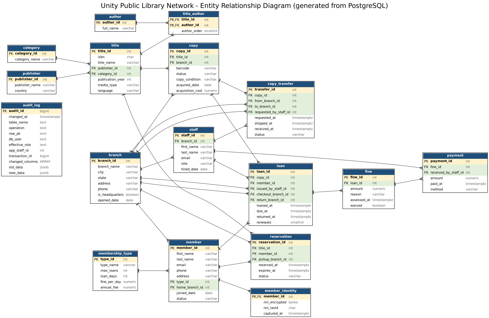
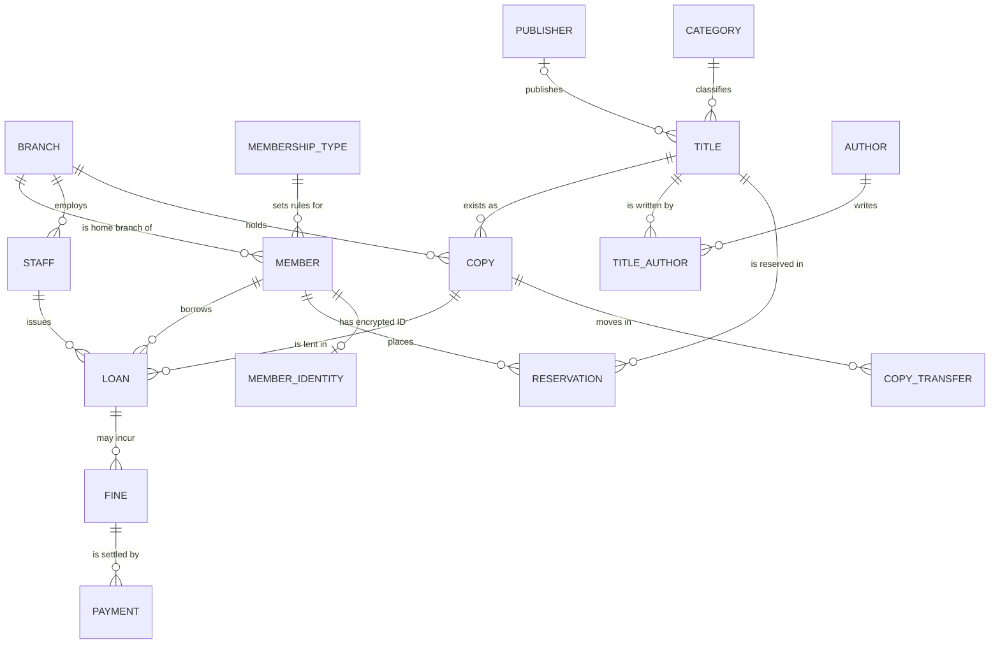

# Portfolio 1: Database Design and Modelling

**Course:** MIT 8103 Advanced Database Systems
**Case study:** Unity Public Library Network (UPLN), a fictional organisation created for this assignment
**DBMS:** PostgreSQL 16 (running in Docker)

## Contents

| File | What it is |
|---|---|
| [`01_schema.sql`](01_schema.sql) | Creates the 15 core tables, the keys, the constraints and one view |
| [`02_sample_data.sql`](02_sample_data.sql) | Small, consistent, synthetic sample data |
| [`03_constraint_tests.sql`](03_constraint_tests.sql) | 18 tests that try to break the rules and show the database refusing them |
| [`04_security_privacy.sql`](04_security_privacy.sql) | Roles, least-privilege permissions, privacy-safe views and row-level security |
| [`05_security_tests.sql`](05_security_tests.sql) | 14 permission tests plus demonstrations of masking and row-level security |
| [`06_audit_log.sql`](06_audit_log.sql) / [`06b_audit_demo.sql`](06b_audit_demo.sql) | Tamper-resistant audit log (adds table 16) and a short demonstration |
| [`07_audit_tests.sql`](07_audit_tests.sql) | 18 tests of the audit log |
| [`08_payment_guard.sql`](08_payment_guard.sql) / [`08b_payment_guard_tests.sql`](08b_payment_guard_tests.sql) | Trigger that stops over-payment and payment of a waived fine, with 6 tests |
| [`09_authentication.sql`](09_authentication.sql) / [`09b_login_tests.sh`](09b_login_tests.sh) | Real login accounts with hashed passwords, and a script that logs in over the network |
| [`10_encryption.sql`](10_encryption.sql) / [`10b_run_encryption.sh`](10b_run_encryption.sh) | Encrypted National Identification Number (adds table 17), password hashing, 10 tests |
| [`11_sql_injection_demo.sql`](11_sql_injection_demo.sql) | An unsafe search being attacked, the safe version, and defence in depth |
| [`er_diagram.png`](er_diagram.png) / [`.svg`](er_diagram.svg) | ER diagram generated from the live database (17 tables) |
| [`er_diagram.mmd`](er_diagram.mmd) | The same model as hand-written Mermaid source (rendered below) |
| [`build_er_diagram.py`](build_er_diagram.py) | Script that produces the diagram from the database |
| `evidence/` | My screenshots of each step |

---

## 1. Case study

**Unity Public Library Network (UPLN)** is a fictional national public library system. It has a headquarters in **Abuja** and four city branches in **Lagos, Port Harcourt, Kano and Enugu**. The network shares one catalogue. Members can borrow and return items at any branch, and copies move between cities on request.

| Question | Answer |
|---|---|
| **Nature of the system** | Lending and circulation management for a multi-city public library |
| **Users of the database** | Members, librarians, branch managers, headquarters administrators |
| **Major data stored** | Branches, membership types, members, staff, publishers, authors, categories, titles, physical copies, loans, reservations, copy transfers, fines, payments |
| **Key operations** | Register a member; search the catalogue; borrow and return a copy; reserve a title; transfer a copy between branches; calculate and pay fines; report on branch activity |

All people, emails and ISBNs in the sample data are synthetic. Fines and fees are in naira (₦).

### Business rules the design must protect

| # | Rule | Enforced by |
|---|---|---|
| R1 | The network has exactly one headquarters | Partial unique index `uq_one_headquarters` |
| R2 | A physical copy can have at most one active loan | Partial unique index `uq_one_active_loan_per_copy` |
| R3 | A member can have only one open reservation per title | Partial unique index `uq_one_open_reservation` |
| R4 | A loan cannot fall due before it starts; a returned loan must record where it was returned | `CHECK` constraints on `loan` |
| R5 | A copy cannot be transferred to the branch it is already at | `CHECK` on `copy_transfer` |
| R6 | Emails, barcodes and ISBNs are unique, and ISBNs are well-formed | `UNIQUE` and `CHECK` |
| R7 | Money amounts are positive; status fields only hold allowed values | `CHECK` |
| R8 | Nothing can point to a record that does not exist | Foreign keys |

---

## 2. Entity-relationship diagram

The diagram below is generated from the database itself by `build_er_diagram.py`, so it always matches the schema. Yellow rows are primary keys and green rows are foreign keys. The "tee" end of a line is the "one" side and the "crow's foot" end is the "many" side.



The same model in Mermaid (GitHub draws this automatically). It shows the main entities and relationships only; the full column lists are in the diagram above and in [`er_diagram.mmd`](er_diagram.mmd):



`audit_log` has no foreign keys on purpose: it records changes to many tables by name and must keep its entries even if the original row is later deleted.

### How to read the main relationships

- **Title vs copy.** A *title* is the work (for example *Things Fall Apart*). A *copy* is one physical item with its own barcode, held at one branch. One title has many copies, and each copy belongs to exactly one title.
- **Title and author are many-to-many.** A textbook can have three authors and an author can write many books, so the link table `title_author` sits between them. Its primary key is the pair (`title_id`, `author_id`).
- **A loan joins a member to a copy.** The loan also records the staff member who issued it and the branch where it was checked out and returned. The checkout and return branches can differ, because members may return items at any branch.
- **Fines hang off loans and payments hang off fines.** One fine can be paid in several instalments.

---

## 3. Relational schema

PK = primary key, FK = foreign key, UQ = unique. Full definitions are in [`01_schema.sql`](01_schema.sql).

| Table | Primary key | Foreign keys | Other keys and notable constraints |
|---|---|---|---|
| `branch` | `branch_id` | none | UQ `branch_name`; one-headquarters rule (R1) |
| `membership_type` | `type_id` | none | UQ `type_name`; `max_loans`, `loan_days` > 0; fee and rate ≥ 0 |
| `member` | `member_id` | `type_id` → membership_type; `home_branch_id` → branch | UQ `email` with format `CHECK`; `status` in (active, suspended, expired) |
| `staff` | `staff_id` | `branch_id` → branch | UQ `email`; `role` in (librarian, branch_manager, administrator) |
| `publisher` | `publisher_id` | none | UQ `publisher_name` |
| `author` | `author_id` | none | none |
| `category` | `category_id` | none | UQ `category_name` |
| `title` | `title_id` | `publisher_id` → publisher; `category_id` → category | UQ `isbn` (13 digits, may be NULL); `media_type` in (book, dvd, audiobook, magazine) |
| `title_author` | (`title_id`, `author_id`) | `title_id` → title; `author_id` → author | composite primary key; `author_order` ≥ 1 |
| `copy` | `copy_id` | `title_id` → title; `branch_id` → branch | UQ `barcode`; `status` and `copy_condition` restricted to allowed values |
| `loan` | `loan_id` | `copy_id`, `member_id`, `issued_by_staff_id`, `checkout_branch_id`, `return_branch_id` | R2 index; due after loan; return time and return branch both set or both NULL; renewals 0 to 2 |
| `reservation` | `reservation_id` | `title_id`, `member_id`, `pickup_branch_id` | R3 index; expiry after reservation time |
| `copy_transfer` | `transfer_id` | `copy_id`, `from_branch_id`, `to_branch_id`, `requested_by_staff_id` | from ≠ to; shipped and received times in order |
| `fine` | `fine_id` | `loan_id` → loan | UQ (`loan_id`, `reason`); `amount` > 0 |
| `payment` | `payment_id` | `fine_id` → fine; `received_by_staff_id` → staff | `amount` > 0; `method` restricted |
| `audit_log` *(added by `06_audit_log.sql`)* | `audit_id` | none, deliberately | `operation` in (INSERT, UPDATE, DELETE); append-only (see section 7.5) |
| `member_identity` *(added by `10_encryption.sql`)* | `member_id` | `member_id` → member (one-to-one) | `nin_encrypted` holds ciphertext only; `nin_last4` must be 4 digits |

The first 15 tables come from `01_schema.sql`. The two security scripts add `audit_log` and `member_identity`, so the finished database has **17 tables**. There is also one **view**, `v_fine_balance`, which computes how much of each fine has been paid and how much is outstanding, and the reporting and audit views described in section 7.

**Why surrogate keys?** Every table uses a system-generated integer key (`GENERATED ALWAYS AS IDENTITY`). Natural values such as names or emails can change or repeat. A surrogate key never changes, so foreign keys stay valid. The natural identifiers (email, barcode, ISBN) are still protected with `UNIQUE`.

**Why no extra indexes?** PostgreSQL automatically indexes primary keys and `UNIQUE` columns, but not foreign keys. I deliberately left the other indexes out so that Portfolio 2 can measure a fair before-and-after improvement.

---

## 4. Keys and constraints in use

| Kind | Example in this schema | What it prevents |
|---|---|---|
| Primary key | `copy.copy_id` | Two rows with the same identity |
| Composite primary key | `title_author (title_id, author_id)` | The same author listed twice on one title |
| Foreign key | `loan.member_id → member` | A loan for a member who does not exist |
| `UNIQUE` | `copy.barcode`, `member.email` | Duplicate barcodes or accounts |
| `NOT NULL` | `member.last_name` | Missing mandatory data |
| `CHECK` | `fine.amount > 0` | Negative or zero money values |
| Partial unique index | one active loan per copy | A copy being lent to two people at once |

The partial indexes are the most useful feature in this design. For example, `uq_one_active_loan_per_copy` is declared as `UNIQUE (copy_id) WHERE returned_at IS NULL`. It only looks at unreturned loans, so a copy can have many *past* loans but only one *current* one. This is documented in the PostgreSQL manual ([partial indexes](https://www.postgresql.org/docs/16/indexes-partial.html)).

---

## 5. Normalisation

Normalisation organises data so that each fact is stored once. This avoids contradictory copies of the same fact and the update, insertion and deletion problems that follow (course notes, Study Session One, "Normalisation").

### 5.1 Starting point: one flat "borrowing sheet"

Imagine the library kept everything in one wide table, one row per loan:

`member_name, member_email, membership_type, loan_days, fine_per_day, home_branch, branch_city, title, isbn, authors, publisher, publisher_country, copy_barcode, branch_holding_copy, loaned_at, due_at, returned_at`

This design has three kinds of problem:

| Anomaly | Example in this system |
|---|---|
| **Update** | If the Student fine rate changes from ₦25 to ₦30, every row of every student loan must be edited. Missing one leaves two different rates for the same membership type. |
| **Insertion** | A new title cannot be recorded until someone borrows it, and a new member cannot be recorded until they borrow something. |
| **Deletion** | Deleting a member's only loan also deletes the only record of the member, and deleting the only loan of a book also deletes the book's details. |

### 5.2 First normal form (1NF): atomic values, no repeating groups

The `authors` column holds a list (for example "Silberschatz, Korth, Sudarshan"). Each cell must hold one value, so authors move into their own table, `author`, joined to titles by `title_author`. One row now means one author on one title.

### 5.3 Second normal form (2NF): no partial dependencies

A loan row is identified by the combination (member, copy, loan time). Many columns depend on only *part* of that identity:

- member name, email and membership type depend only on the **member**, so they move to `member`.
- title, ISBN and publisher depend only on the **copy** (through its title), so they move to `title` and `copy`.

### 5.4 Third normal form (3NF): no transitive dependencies

A non-key column must depend on the key and nothing else. These chains were removed:

| Chain (A → B → C) | Problem | Fix |
|---|---|---|
| `member_id → type_id → loan_days, fine_per_day, max_loans` | Loan rules repeated on every member | Rules stored once in `membership_type` |
| `title_id → publisher_id → publisher_country` | Country repeated for every title | `publisher` table |
| `title_id → category_id → category_name` | Category text repeated | `category` table |
| `member_id → home_branch_id → branch_city` | City repeated for every member | `branch` table |

### 5.5 Boyce-Codd normal form (BCNF) check

In each table, every column that determines other columns is a candidate key. For example, in `member` both `member_id` and `email` identify a member, and both are protected by key constraints (`PRIMARY KEY` and `UNIQUE`). In `title_author` the only determinant is the composite key. No table has a determinant that is not a key, so the schema meets BCNF.

### 5.6 Deliberate exceptions (controlled denormalisation)

A good design explains where it *chooses* to bend the rules. I made three such choices:

| Choice | Why | Risk and how I manage it |
|---|---|---|
| `copy.status` (for example `on_loan`) can be worked out from the loans table | Checking availability must be fast, and Portfolio 3 needs a single row to lock when two people borrow the same copy | The two could drift apart. A check query (below) finds any mismatch, and the transactions in Portfolio 3 update both together |
| `copy.branch_id` (where a copy currently is) can be worked out from the latest return or transfer | Same reason: fast lookup for "what is at this branch?" | Same protection |
| `loan.checkout_branch_id` and `return_branch_id` are stored even though the issuing staff member has a home branch | A staff member may work a shift at another branch, so the branch of the *event* is a separate fact from the branch of the *employee* | Both are foreign keys, so they must be real branches |

I **avoided** one denormalisation: I did not store a "paid / unpaid" status on `fine`. It is computed from the payments by `v_fine_balance`, so it can never go out of step with them.

Consistency check for the first exception (expected result: zero rows):

```sql
SELECT c.copy_id, c.status, l.loan_id
FROM copy c
LEFT JOIN loan l ON l.copy_id = c.copy_id AND l.returned_at IS NULL
WHERE (c.status = 'on_loan') <> (l.loan_id IS NOT NULL);
```

---

## 6. How to run it

From the repository root, with the database container running (`docker compose up -d`):

```bash
docker compose exec -T postgres psql -U library_admin -d upln -v ON_ERROR_STOP=1 < portfolio-1-database-design/01_schema.sql
docker compose exec -T postgres psql -U library_admin -d upln -v ON_ERROR_STOP=1 < portfolio-1-database-design/02_sample_data.sql
docker compose exec -T postgres psql -U library_admin -d upln < portfolio-1-database-design/03_constraint_tests.sql
docker compose exec -T postgres psql -U library_admin -d upln -v ON_ERROR_STOP=1 < portfolio-1-database-design/04_security_privacy.sql
docker compose exec -T postgres psql -U library_admin -d upln < portfolio-1-database-design/05_security_tests.sql
docker compose exec -T postgres psql -U library_admin -d upln -v ON_ERROR_STOP=1 < portfolio-1-database-design/06_audit_log.sql
docker compose exec -T postgres psql -U library_admin -d upln < portfolio-1-database-design/06b_audit_demo.sql
docker compose exec -T postgres psql -U library_admin -d upln < portfolio-1-database-design/07_audit_tests.sql
docker compose exec -T postgres psql -U library_admin -d upln -v ON_ERROR_STOP=1 < portfolio-1-database-design/08_payment_guard.sql
docker compose exec -T postgres psql -U library_admin -d upln < portfolio-1-database-design/08b_payment_guard_tests.sql
bash portfolio-1-database-design/09b_login_tests.sh
bash portfolio-1-database-design/10b_run_encryption.sh
docker compose exec -T postgres psql -U library_admin -d upln < portfolio-1-database-design/11_sql_injection_demo.sql
```

Run them in this order. `06b` makes four real changes that stay in the audit log, and `09b` and `10b` generate random passwords and keys that exist only in the terminal session (nothing secret is written to the repository).

The scripts are safe to re-run: the schema script drops and recreates the 15 core tables, and the sample data always loads the same rows. After re-running `01_schema.sql` run `04` and `06` to `10` again, because the roles' permissions, triggers and extra tables belong to the objects that were dropped.

To regenerate the diagram (needs the PostgreSQL client and Graphviz: `sudo apt-get update && sudo apt-get install -y postgresql-client graphviz`):

```bash
cd portfolio-1-database-design
PGHOST=localhost PGUSER=library_admin PGPASSWORD=library_dev_pw PGDATABASE=upln python3 build_er_diagram.py
```

### Expected results

- Schema script: no errors; `\dt` lists 15 tables.
- Sample data: 5 branches, 3 membership types, 8 members, 8 staff, 10 titles, 19 copies, 10 loans, 3 fines.
- Constraint tests: **18 rows, every one marked `PASS (rejected)`**, followed by one valid loan that is accepted and then rolled back.
- Security script: no errors.
- Security tests: **14 rows, every one marked `PASS`**, then the masked member list, and the row-level security demonstrations (member 1 sees 2 loans, member 7 sees 2 loans, a logged-out member sees 0, a librarian sees all 10).
- Audit demo: 4 audit entries, with the tampering attempt refused. Audit tests: **18 rows, every one `PASS`**.
- Payment guard tests: **6 rows, every one `PASS`**.
- Login script: a wrong password is refused (`FATAL: password authentication failed`); the librarian login cannot delete loans or read the audit log; the auditor sees the real login name in the trail.
- Encryption: **10 rows, every one `PASS`**. SQL injection demo: the unsafe search returns 1, 8 and 8 rows for the three inputs; the safe search returns 1, 0 and 0; the last attack is refused for the member-app role.

One detail worth knowing: after the tests, the valid test loan shows an ID higher than 11. This is normal. PostgreSQL's ID counters never roll back, so the failed inserts "used up" some numbers. IDs are unique, not gap-free.

---

## 7. Security and privacy

A library holds personal data about its members (names, emails, phone numbers, home addresses, and in this design an identity number) and its borrowing history, which reveals what people read. Protecting that data is part of good database design. The course notes (Study Session Three) list the mechanisms of database security: authentication and authorisation, access control, encryption, auditing and monitoring, and backup and recovery. Data protection law also applies: in Nigeria this is the **Nigeria Data Protection Act 2023 (NDPA)**, whose principles include collecting only the data needed and keeping it secure. The table below shows which mechanism is covered where.

| Course mechanism | What I implemented | Section | Script |
|---|---|---|---|
| Authorisation, role-based access control, least privilege | Five job roles, column-level permissions, separation of duties | 7.1 | `04`, `05` |
| Privacy by design / data minimisation | Masking views, redacted audit entries, row-level security | 7.2, 7.3, 7.5 | `04`, `06` |
| Auditing | Append-only audit log fed by triggers | 7.5 | `06`, `07` |
| Integrity of money | Payment guard trigger | 7.6 | `08` |
| Authentication | Login accounts, SCRAM-SHA-256 password hashes, expiry | 7.7 | `09` |
| Encryption | Encrypted identity number, salted password hashing; transit and disk encryption explained | 7.8 | `10` |
| Injection attacks | Unsafe versus safe query, with least privilege as a safety net | 7.9 | `11` |
| Monitoring, backup and recovery | **Not in this portfolio.** Backup, recovery and cloud monitoring are covered in Portfolio 5 | 7.10 | |

### 7.1 Roles and least privilege

Instead of giving every user the same powers, I created one **role** per kind of user. Each role is given only what its job needs, and everything starts from "no access".

| Role | Who it represents | What it may do | What it may not do |
|---|---|---|---|
| `upln_librarian` | Front-desk staff | Read catalogue, members, loans; issue loans; take payments; update a member's phone, address and status; update a copy's status and location | Delete anything; change a member's name or email; waive fines |
| `upln_branch_manager` | Branch managers | Everything a librarian can, plus manage the collection and transfers, and **waive fines** | Delete records |
| `upln_hq_admin` | Headquarters administrators | Full data access, including deletes; may read the audit log | Change the database structure (they do not own the tables), act as a superuser, or alter the audit log |
| `upln_analyst` | Reporting and planning staff | Read two privacy-safe views only | Read any raw table |
| `upln_member_self` | The member self-service app | Read the public catalogue and *their own* records | Edit anything; read staff, fines or payments |
| `upln_auditor` | Auditor (added in `06`) | Read the audit trail | Change any data |

Two details worth noting:
- **Column-level permissions.** A librarian may update a member's `phone`, `address` and `status`, but not `email` or the name. Permissions can be granted per column, not just per table.
- **Separation of duties.** Only a branch manager can waive a fine. A librarian who takes payments cannot also cancel what a member owes.

### 7.2 Privacy-safe views (data minimisation)

Analysts need statistics, not personal details. The view `v_member_directory_masked` shows each member as, for example, *Adaeze O., ad\*\*\*@example.com, Standard, Lagos*, and leaves out the phone number and address completely. The view `v_branch_activity` shows only totals per branch. The analyst role has **no access to the underlying tables**, so the views are the only way in. This follows the principle of collecting and exposing no more personal data than the task needs.

### 7.3 Row-level security

For the member self-service app, table permissions alone are not enough, because members must see *some* rows of `loan` and `member` (their own) but not others. PostgreSQL's **row-level security** solves this. The app tells the database who is logged in (`SET app.current_member_id = '1'`), and a policy lets that role see only rows where `member_id` matches. Without a login, the member role sees **zero** rows. Staff roles have an explicit "see all rows" policy, because once row-level security is switched on, a role with no matching policy sees nothing.

### 7.4 Results of the first security layer

The 14 tests in `05_security_tests.sql` all pass. For example, a librarian's attempt to delete a loan and a branch manager's attempt to waive a fine are tested in both directions: refused for the role that should not have the power, allowed for the role that should. I also checked the test harness itself by giving it two deliberately wrong expectations, and it correctly reported `FAIL` for both.

### 7.5 Audit log (who did what, and when)

Permissions say who *may* act. An audit log records who *did*. `06_audit_log.sql` adds a table `audit_log` and a trigger on eight tables (`member`, `staff`, `loan`, `fine`, `payment`, `copy`, `reservation` and later `member_identity`). Every insert, update or delete writes one row: the time, the table, the row's key, the login name, the role in force, the staff member named by the application (`SET app.staff_id`), which columns changed, and the old and new values as JSON.

Design decisions:
- **Privacy inside the log.** Phone numbers, addresses and the encrypted identity value are replaced by `[REDACTED]` in the log. The log shows *that* a phone number changed, not what it is, so the audit trail does not become a second copy of personal data.
- **The log cannot be avoided.** The trigger function is `SECURITY DEFINER`, so ordinary users, who have no access to the log, still cause entries to be written. A change that fails and rolls back leaves no entry, because the entry is part of the same transaction.
- **The log cannot be altered.** No role is granted write access, and further triggers refuse `UPDATE`, `DELETE` and `TRUNCATE` even for the table owner. Only the auditor and HQ administrator roles may read it.
- **A bug I found and fixed.** My first version recorded the function owner's name as the acting role, because inside a `SECURITY DEFINER` function the current user is the owner. My own test caught it. The fix reads the role from the `role` setting, and the tests now check that the role is recorded correctly.

`07_audit_tests.sql` runs 18 tests (changes are logged with the right facts, redaction works, the administrator cannot update, delete or truncate the log, nobody can forge an entry, only the right roles can read it). It runs inside a transaction that is rolled back, so it leaves no trace. I also confirmed the tests can fail: in a scratch copy I deliberately removed the protective trigger on the log, the audit trigger on `member` and a permission, and six of the tests reported `FAIL`.

### 7.6 Payment guard

`08_payment_guard.sql` adds a trigger on `payment`. It locks the fine's row, then refuses a payment that exceeds the outstanding balance, a payment on a waived fine, and a payment on a fine that does not exist. The lock matters for concurrency: two cashiers paying the same fine at the same moment are checked one after the other, not both against the same old balance. `08b_payment_guard_tests.sql` passes 6 tests, including two payments that together exceed the balance. Portfolio 3 will test the two-cashier case with real concurrent sessions.

### 7.7 Authentication

So far the roles were job titles that nobody could log in as. `09_authentication.sql` creates two real accounts, `staff_amina` (a librarian) and `auditor_ngozi` (the auditor), and gives each the rights of one job role. They cannot create users or databases and are not superusers.

- **No password in the repository.** `09b_login_tests.sh` generates random passwords for the run, passes them to the script and never writes them to a file. The database stores only a salted **SCRAM-SHA-256** hash (the `SCRAM-SHA-256$…` value shown in the evidence), and the passwords expire on 30 June 2027.
- **Proof by logging in.** The script connects over the network. A wrong password is refused with `FATAL: password authentication failed`. The librarian login is refused when it tries to delete a loan or read the audit log. The auditor sees the real login name `staff_amina` in the audit trail.
- **How the server decides.** The evidence shows the connection rules (`pg_hba.conf`): network connections must prove identity with `scram-sha-256`. The `trust` lines are the container's own local connections inside the practice container, which would not exist in production.

### 7.8 Encryption and hashing

`10_encryption.sql` uses the `pgcrypto` extension.
- **Encrypted identifier.** A table `member_identity` stores a National Identification Number (synthetic values only) as ciphertext produced with AES-256 (`pgp_sym_encrypt`), plus the last four digits for desk staff. Without the key, a stolen database file or backup shows only scrambled bytes. The key is supplied at run time from outside the database and is never committed. Ten tests pass: the plain number is not found in the stored bytes; the right key recovers it; a wrong key fails; the same number encrypts to different bytes each time; a librarian can read only the last four digits; an analyst cannot read the table; the audit log hides the encrypted value; and password hashing (`bcrypt` with a random salt) accepts the right password, rejects a wrong one and gives different hashes for the same password.
- **Encryption in transit and at rest (honest scope).** The script checks the connection and reports that TLS is **off** in this practice container, which is reached over a private Docker network. I did not enable it here. A production or cloud deployment must require TLS and encrypted storage, and Portfolio 5 covers this in the cloud context.
- **Key management.** A key held by the application, as in the demo, is only as safe as the place it is kept. A real system would keep it in a secrets manager and rotate it.

### 7.9 SQL injection

`11_sql_injection_demo.sql` shows why the way queries are built matters. An unsafe search that glues the user's text into the command is attacked with the input `x' OR '1'='1`, which returns every member (8 rows instead of 1), and with a `UNION` input that returns staff email addresses from a different table. The safe version passes the text as a bound parameter, so the same inputs find nothing. The third part shows **defence in depth**: the same unsafe code is attacked while acting as the member-app role. Row-level security limits the "match all" attack to that member's own row, and the data-theft attack is refused outright because the role has no right to read the staff table. The vulnerable function exists only for the session and is not left in the database.

(While building this demo my first version of the third part reported a syntax error that looked like a permission refusal. I noticed the message was wrong, fixed the test, and re-ran it so the evidence shows the real permission error.)

### 7.10 What I did not do, and why

| Topic | Position |
|---|---|
| **Group-role passwords** | The five job roles are group roles with no login. Only the two demonstration accounts can log in, with random run-time passwords. |
| **The `docker-compose.yml` password** | `library_dev_pw` is committed for convenience. That is only acceptable because the database is a throwaway practice instance that holds **synthetic data only** and is not reachable from the internet. A real system would never commit it. |
| **TLS and disk encryption** | Not enabled in the practice container (see 7.8). Covered conceptually here and in the cloud design in Portfolio 5. |
| **Monitoring and alerting** | The audit log supports investigation after the fact, but I did not build live alerting. A production system would feed the log and the server logs to a monitoring tool. |
| **Backup and recovery** | Planned for Portfolio 5, where it is combined with replication, recovery point and recovery time. |
| **Audit log storage** | The log lives in the same database. A database superuser could still disable its protective triggers. A production system would also ship the log to separate write-once storage. |
| **Real data** | All names, emails, phone numbers and identity numbers are synthetic, and the emails use the reserved `example.com` domain, so no real person's data is stored in this repository. |

### 7.11 Test summary for the security work

| Script | Tests | Result |
|---|---|---|
| `03_constraint_tests.sql` | 18 integrity tests | all pass |
| `05_security_tests.sql` | 14 permission tests | all pass |
| `07_audit_tests.sql` | 18 audit tests | all pass |
| `08b_payment_guard_tests.sql` | 6 payment tests | all pass |
| `10_encryption.sql` | 10 encryption and hashing tests | all pass |
| `09b_login_tests.sh`, `11_sql_injection_demo.sql` | demonstrations (observed outcomes, shown in the evidence) | as described above |

---

## 8. Evidence

Screenshots are in [`evidence/`](evidence/):

| File | Shows |
|---|---|
| `01_tables_created.png` | `\dt` listing the 15 core tables (taken before the security scripts added two more) |
| `02_sample_data_loaded.png` | Row counts after loading the data |
| `03_constraint_tests.png` | All 18 tests passing |
| `04_fine_balance_view.png` | Output of `SELECT * FROM v_fine_balance;` |
| `05_security_tests.png` | All 14 security tests passing |
| `06_row_level_security.png` | Row-level security demonstrations (members 1 and 7, nobody logged in, librarian) |
| `07_audit_log_demo.png` | A simulated working day and the auditor's view of the trail; the tampering attempt is refused |
| `08_audit_tests.png` | All 18 audit tests passing |
| `09_payment_guard_tests.png` | All 6 payment guard tests passing |
| `10_authentication_a.png`, `10_authentication_b.png` | Hashed passwords, roles, connection rules, then wrong password refused, correct login accepted, least privilege and the audit trail showing the real login name |
| `11_encryption.png` | Ciphertext in the table, all 10 encryption tests passing, and the TLS check |
| `12_sql_injection_a.png`, `12_sql_injection_b.png` | Unsafe search attacked, safe search resisting, and the defence-in-depth refusal |

---

## 9. Design decisions, limitations and future work

- **Single-currency, single-country.** All money is in naira, and there is no tax or currency conversion.
- **Audit scope.** The audit log records changes (insert, update, delete). It does not record who merely *read* personal data. Read-auditing would need database logging or an extension and is listed as future work.
- **Reservation queue order** is implied by `reserved_at`. A real system would also need rules for which returned copy satisfies which reservation. Portfolio 3 touches on this.
- **Data volume.** The sample data is deliberately tiny so it can be read and checked by hand. Portfolio 2 generates much larger data to test performance.

## Sources

- MIVA Open University (2025). *Advanced Database Systems*, Study Session One: Review of Traditional Relational Databases and Advanced Concepts (database design, keys, normalisation).
- MIVA Open University (2025). *Advanced Database Systems*, Study Session Three (database security) and Study Session Six (data privacy): role-based access control, least privilege, encryption, data protection regulation.
- PostgreSQL Global Development Group. *PostgreSQL 16 Documentation: Privileges* and *Row Security Policies*. https://www.postgresql.org/docs/16/ddl-priv.html and https://www.postgresql.org/docs/16/ddl-rowsecurity.html
- PostgreSQL Global Development Group. *PostgreSQL 16 Documentation: Partial Indexes*. https://www.postgresql.org/docs/16/indexes-partial.html
- Federal Republic of Nigeria (2023). *Nigeria Data Protection Act, 2023.* Nigeria Data Protection Commission.
- PostgreSQL Global Development Group. *PostgreSQL 16 Documentation: Password Authentication* (SCRAM), *The pg_hba.conf File*, *CREATE TRIGGER*, *CREATE FUNCTION* (SECURITY DEFINER) and *pgcrypto*. https://www.postgresql.org/docs/16/
- OWASP Foundation. *SQL Injection Prevention Cheat Sheet.* https://cheatsheetseries.owasp.org/cheatsheets/SQL_Injection_Prevention_Cheat_Sheet.html
