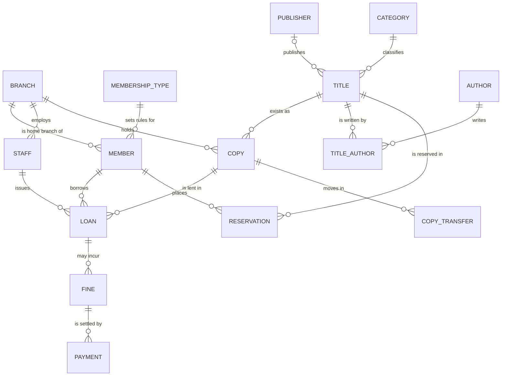

# Portfolio 1: Database Design and Modelling

**Course:** MIT 8103 Advanced Database Systems
**Case study:** Unity Public Library Network (UPLN), a fictional organisation created for this assignment
**DBMS:** PostgreSQL 16 (running in Docker)

## Contents

| File | What it is |
|---|---|
| [`01_schema.sql`](01_schema.sql) | Creates all 15 tables, the keys, the constraints and one view |
| [`02_sample_data.sql`](02_sample_data.sql) | Small, consistent, synthetic sample data |
| [`03_constraint_tests.sql`](03_constraint_tests.sql) | 18 tests that try to break the rules and show the database refusing them |
| [`er_diagram.png`](er_diagram.png) / [`.svg`](er_diagram.svg) | ER diagram generated from the live database |
| [`er_diagram.mmd`](er_diagram.mmd) | The same model as hand-written Mermaid source (rendered below) |
| [`build_er_diagram.py`](build_er_diagram.py) | Script that produces the diagram from the database |
| `evidence/` | My screenshots of each step |

---

## 1. Case study

**Unity Public Library Network (UPLN)** is a fictional national public library system. It has a headquarters in **Abuja** and four city branches in **Lagos, Port Harcourt, Kano and Enugu**. The network shares one catalogue. Members can borrow and return items at any branch, and copies move between cities on request.

| Question | Answer |
|---|---|
| **Nature of the system** | Lending and circulation management for a multi-city public library |
| **Users of the database** | Members, librarians, branch managers, headquarters administrators |
| **Major data stored** | Branches, membership types, members, staff, publishers, authors, categories, titles, physical copies, loans, reservations, copy transfers, fines, payments |
| **Key operations** | Register a member; search the catalogue; borrow and return a copy; reserve a title; transfer a copy between branches; calculate and pay fines; report on branch activity |

All people, emails and ISBNs in the sample data are synthetic. Fines and fees are in naira (₦).

### Business rules the design must protect

| # | Rule | Enforced by |
|---|---|---|
| R1 | The network has exactly one headquarters | Partial unique index `uq_one_headquarters` |
| R2 | A physical copy can have at most one active loan | Partial unique index `uq_one_active_loan_per_copy` |
| R3 | A member can have only one open reservation per title | Partial unique index `uq_one_open_reservation` |
| R4 | A loan cannot fall due before it starts; a returned loan must record where it was returned | `CHECK` constraints on `loan` |
| R5 | A copy cannot be transferred to the branch it is already at | `CHECK` on `copy_transfer` |
| R6 | Emails, barcodes and ISBNs are unique, and ISBNs are well-formed | `UNIQUE` and `CHECK` |
| R7 | Money amounts are positive; status fields only hold allowed values | `CHECK` |
| R8 | Nothing can point to a record that does not exist | Foreign keys |

---

## 2. Entity-relationship diagram

The diagram below is generated from the database itself by `build_er_diagram.py`, so it always matches the schema. Yellow rows are primary keys and green rows are foreign keys. The "tee" end of a line is the "one" side and the "crow's foot" end is the "many" side.


The same model in Mermaid (GitHub draws this automatically). It shows the main entities and relationships only; the full column lists are in the diagram above and in [`er_diagram.mmd`](er_diagram.mmd):



### How to read the main relationships

- **Title vs copy.** A *title* is the work (for example *Things Fall Apart*). A *copy* is one physical item with its own barcode, held at one branch. One title has many copies, and each copy belongs to exactly one title.
- **Title and author are many-to-many.** A textbook can have three authors and an author can write many books, so the link table `title_author` sits between them. Its primary key is the pair (`title_id`, `author_id`).
- **A loan joins a member to a copy.** The loan also records the staff member who issued it and the branch where it was checked out and returned. The checkout and return branches can differ, because members may return items at any branch.
- **Fines hang off loans and payments hang off fines.** One fine can be paid in several instalments.

---

## 3. Relational schema

PK = primary key, FK = foreign key, UQ = unique. Full definitions are in [`01_schema.sql`](01_schema.sql).

| Table | Primary key | Foreign keys | Other keys and notable constraints |
|---|---|---|---|
| `branch` | `branch_id` | none | UQ `branch_name`; one-headquarters rule (R1) |
| `membership_type` | `type_id` | none | UQ `type_name`; `max_loans`, `loan_days` > 0; fee and rate ≥ 0 |
| `member` | `member_id` | `type_id` → membership_type; `home_branch_id` → branch | UQ `email` with format `CHECK`; `status` in (active, suspended, expired) |
| `staff` | `staff_id` | `branch_id` → branch | UQ `email`; `role` in (librarian, branch_manager, administrator) |
| `publisher` | `publisher_id` | none | UQ `publisher_name` |
| `author` | `author_id` | none | none |
| `category` | `category_id` | none | UQ `category_name` |
| `title` | `title_id` | `publisher_id` → publisher; `category_id` → category | UQ `isbn` (13 digits, may be NULL); `media_type` in (book, dvd, audiobook, magazine) |
| `title_author` | (`title_id`, `author_id`) | `title_id` → title; `author_id` → author | composite primary key; `author_order` ≥ 1 |
| `copy` | `copy_id` | `title_id` → title; `branch_id` → branch | UQ `barcode`; `status` and `copy_condition` restricted to allowed values |
| `loan` | `loan_id` | `copy_id`, `member_id`, `issued_by_staff_id`, `checkout_branch_id`, `return_branch_id` | R2 index; due after loan; return time and return branch both set or both NULL; renewals 0 to 2 |
| `reservation` | `reservation_id` | `title_id`, `member_id`, `pickup_branch_id` | R3 index; expiry after reservation time |
| `copy_transfer` | `transfer_id` | `copy_id`, `from_branch_id`, `to_branch_id`, `requested_by_staff_id` | from ≠ to; shipped and received times in order |
| `fine` | `fine_id` | `loan_id` → loan | UQ (`loan_id`, `reason`); `amount` > 0 |
| `payment` | `payment_id` | `fine_id` → fine; `received_by_staff_id` → staff | `amount` > 0; `method` restricted |

There is also one **view**, `v_fine_balance`, which computes how much of each fine has been paid and how much is outstanding.

**Why surrogate keys?** Every table uses a system-generated integer key (`GENERATED ALWAYS AS IDENTITY`). Natural values such as names or emails can change or repeat. A surrogate key never changes, so foreign keys stay valid. The natural identifiers (email, barcode, ISBN) are still protected with `UNIQUE`.

**Why no extra indexes?** PostgreSQL automatically indexes primary keys and `UNIQUE` columns, but not foreign keys. I deliberately left the other indexes out so that Portfolio 2 can measure a fair before-and-after improvement.

---

## 4. Keys and constraints in use

| Kind | Example in this schema | What it prevents |
|---|---|---|
| Primary key | `copy.copy_id` | Two rows with the same identity |
| Composite primary key | `title_author (title_id, author_id)` | The same author listed twice on one title |
| Foreign key | `loan.member_id → member` | A loan for a member who does not exist |
| `UNIQUE` | `copy.barcode`, `member.email` | Duplicate barcodes or accounts |
| `NOT NULL` | `member.last_name` | Missing mandatory data |
| `CHECK` | `fine.amount > 0` | Negative or zero money values |
| Partial unique index | one active loan per copy | A copy being lent to two people at once |

The partial indexes are the most useful feature in this design. For example, `uq_one_active_loan_per_copy` is declared as `UNIQUE (copy_id) WHERE returned_at IS NULL`. It only looks at unreturned loans, so a copy can have many *past* loans but only one *current* one. This is documented in the PostgreSQL manual ([partial indexes](https://www.postgresql.org/docs/16/indexes-partial.html)).

---

## 5. Normalisation

Normalisation organises data so that each fact is stored once. This avoids contradictory copies of the same fact and the update, insertion and deletion problems that follow (course notes, Study Session One, "Normalisation").

### 5.1 Starting point: one flat "borrowing sheet"

Imagine the library kept everything in one wide table, one row per loan:

`member_name, member_email, membership_type, loan_days, fine_per_day, home_branch, branch_city, title, isbn, authors, publisher, publisher_country, copy_barcode, branch_holding_copy, loaned_at, due_at, returned_at`

This design has three kinds of problem:

| Anomaly | Example in this system |
|---|---|
| **Update** | If the Student fine rate changes from ₦25 to ₦30, every row of every student loan must be edited. Missing one leaves two different rates for the same membership type. |
| **Insertion** | A new title cannot be recorded until someone borrows it, and a new member cannot be recorded until they borrow something. |
| **Deletion** | Deleting a member's only loan also deletes the only record of the member, and deleting the only loan of a book also deletes the book's details. |

### 5.2 First normal form (1NF): atomic values, no repeating groups

The `authors` column holds a list (for example "Silberschatz, Korth, Sudarshan"). Each cell must hold one value, so authors move into their own table, `author`, joined to titles by `title_author`. One row now means one author on one title.

### 5.3 Second normal form (2NF): no partial dependencies

A loan row is identified by the combination (member, copy, loan time). Many columns depend on only *part* of that identity:

- member name, email and membership type depend only on the **member**, so they move to `member`.
- title, ISBN and publisher depend only on the **copy** (through its title), so they move to `title` and `copy`.

### 5.4 Third normal form (3NF): no transitive dependencies

A non-key column must depend on the key and nothing else. These chains were removed:

| Chain (A → B → C) | Problem | Fix |
|---|---|---|
| `member_id → type_id → loan_days, fine_per_day, max_loans` | Loan rules repeated on every member | Rules stored once in `membership_type` |
| `title_id → publisher_id → publisher_country` | Country repeated for every title | `publisher` table |
| `title_id → category_id → category_name` | Category text repeated | `category` table |
| `member_id → home_branch_id → branch_city` | City repeated for every member | `branch` table |

### 5.5 Boyce-Codd normal form (BCNF) check

In each table, every column that determines other columns is a candidate key. For example, in `member` both `member_id` and `email` identify a member, and both are protected by key constraints (`PRIMARY KEY` and `UNIQUE`). In `title_author` the only determinant is the composite key. No table has a determinant that is not a key, so the schema meets BCNF.

### 5.6 Deliberate exceptions (controlled denormalisation)

A good design explains where it *chooses* to bend the rules. I made three such choices:

| Choice | Why | Risk and how I manage it |
|---|---|---|
| `copy.status` (for example `on_loan`) can be worked out from the loans table | Checking availability must be fast, and Portfolio 3 needs a single row to lock when two people borrow the same copy | The two could drift apart. A check query (below) finds any mismatch, and the transactions in Portfolio 3 update both together |
| `copy.branch_id` (where a copy currently is) can be worked out from the latest return or transfer | Same reason: fast lookup for "what is at this branch?" | Same protection |
| `loan.checkout_branch_id` and `return_branch_id` are stored even though the issuing staff member has a home branch | A staff member may work a shift at another branch, so the branch of the *event* is a separate fact from the branch of the *employee* | Both are foreign keys, so they must be real branches |

I **avoided** one denormalisation: I did not store a "paid / unpaid" status on `fine`. It is computed from the payments by `v_fine_balance`, so it can never go out of step with them.

Consistency check for the first exception (expected result: zero rows):

```sql
SELECT c.copy_id, c.status, l.loan_id
FROM copy c
LEFT JOIN loan l ON l.copy_id = c.copy_id AND l.returned_at IS NULL
WHERE (c.status = 'on_loan') <> (l.loan_id IS NOT NULL);
```

---

## 6. How to run it

From the repository root, with the database container running (`docker compose up -d`):

```bash
docker compose exec -T postgres psql -U library_admin -d upln -v ON_ERROR_STOP=1 < portfolio-1-database-design/01_schema.sql
docker compose exec -T postgres psql -U library_admin -d upln -v ON_ERROR_STOP=1 < portfolio-1-database-design/02_sample_data.sql
docker compose exec -T postgres psql -U library_admin -d upln < portfolio-1-database-design/03_constraint_tests.sql
```

The scripts are safe to re-run: the schema script drops and recreates everything, and the sample data always loads the same rows.

To regenerate the diagram (needs the PostgreSQL client and Graphviz: `sudo apt-get update && sudo apt-get install -y postgresql-client graphviz`):

```bash
cd portfolio-1-database-design
PGHOST=localhost PGUSER=library_admin PGPASSWORD=library_dev_pw PGDATABASE=upln python3 build_er_diagram.py
```

### Expected results

- Schema script: no errors; `\dt` lists 15 tables.
- Sample data: 5 branches, 3 membership types, 8 members, 8 staff, 10 titles, 19 copies, 10 loans, 3 fines.
- Constraint tests: **18 rows, every one marked `PASS (rejected)`**, followed by one valid loan that is accepted and then rolled back.

One detail worth knowing: after the tests, the valid test loan shows an ID higher than 11. This is normal. PostgreSQL's ID counters never roll back, so the failed inserts "used up" some numbers. IDs are unique, not gap-free.

---

## 7. Evidence

Screenshots are in [`evidence/`](evidence/):

| File | Shows |
|---|---|
| `01_tables_created.png` | `\dt` listing the 15 tables |
| `02_sample_data_loaded.png` | Row counts after loading the data |
| `03_constraint_tests.png` | All 18 tests passing |
| `04_fine_balance_view.png` | Output of `SELECT * FROM v_fine_balance;` |

---

## 8. Design decisions, limitations and future work

- **Single-currency, single-country.** All money is in naira, and there is no tax or currency conversion.
- **No audit history.** The schema stores the current state plus loan, transfer and payment history, but it does not keep a log of every edit. A production system would add one.
- **Reservation queue order** is implied by `reserved_at`. A real system would also need rules for which returned copy satisfies which reservation. Portfolio 3 touches on this.
- **Data volume.** The sample data is deliberately tiny so it can be read and checked by hand. Portfolio 2 generates much larger data to test performance.

## Sources

- MIVA Open University (2025). *Advanced Database Systems*, Study Session One: Review of Traditional Relational Databases and Advanced Concepts (database design, keys, normalisation).
- PostgreSQL Global Development Group. *PostgreSQL 16 Documentation: Partial Indexes*. https://www.postgresql.org/docs/16/indexes-partial.html
